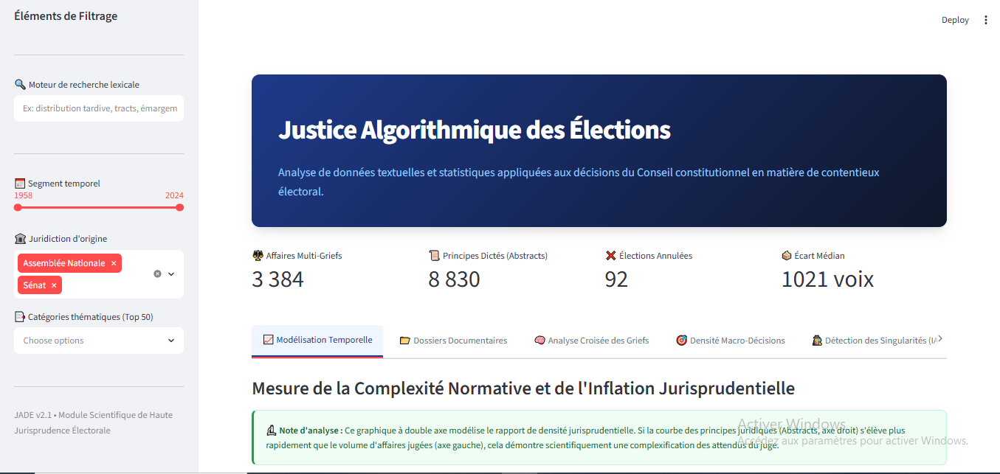
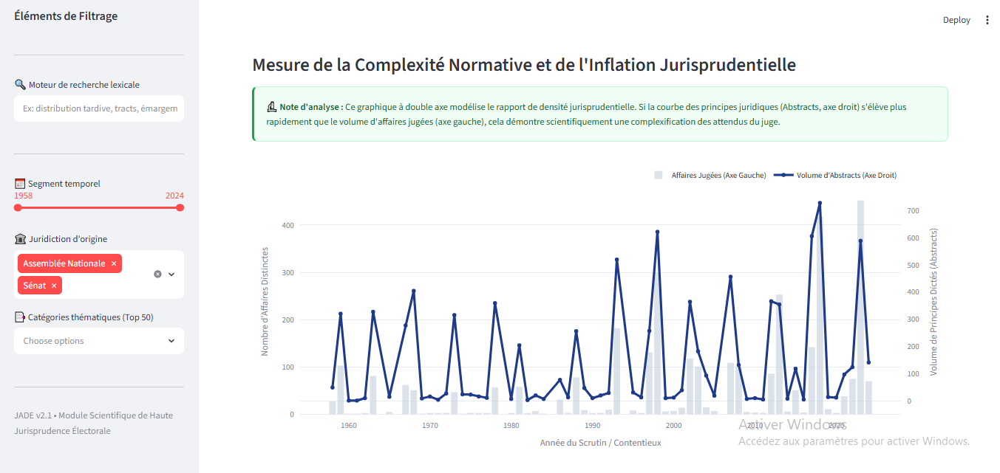
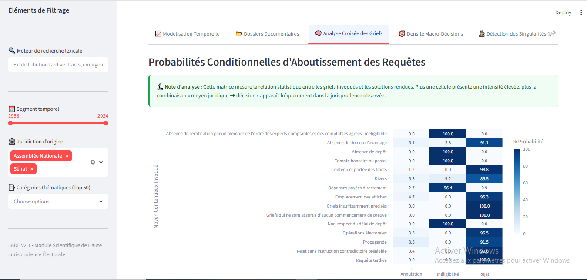

# JADE — Justice Algorithmique des Décisions Électorales

**Analyse des décisions électorales du Conseil constitutionnel | Python • PostgreSQL • ETL • NLP • Streamlit**

## 1. Présentation

JADE est un projet de recherche universitaire consacré à l'analyse et à la structuration des décisions du Conseil constitutionnel français en matière de contentieux électoral.

Réalisé dans le cadre d'un Travail d'Étude et de Recherche (TER) à l'Université Grenoble Alpes en 2026, le projet vise à transformer des données juridiques hétérogènes en informations structurées, exploitables pour l'analyse statistique et l'exploration documentaire.

Il associe l'ingénierie des données, le traitement automatique du langage et la visualisation interactive.

## 2. Objectifs

- Extraire et intégrer les abstracts juridiques.
- Identifier les décisions relatives à l'Assemblée nationale et au Sénat.
- Nettoyer et normaliser les références et textes juridiques.
- Détecter les incohérences et contrôler la qualité des données.
- Construire une base analytique PostgreSQL.
- Explorer les contentieux électoraux à travers un tableau de bord interactif.
- Faciliter l'exploitation scientifique des données par les chercheurs.

## 3. Technologies utilisées

| Domaine | Technologies |
|---|---|
| Développement | Python |
| Traitement des données | Pandas, Regex, JSON, Excel |
| Base de données | PostgreSQL, SQL |
| Data Engineering | ETL, nettoyage, validation, normalisation |
| Analyse de données | Jupyter Notebook, statistiques descriptives |
| NLP / Machine Learning | TF-IDF, régression logistique |
| Visualisation | Streamlit, Plotly |
| Tests | pytest |
| Versionnement | Git, GitLab |

## 4. Architecture du projet

Le projet s'appuie sur deux environnements complémentaires :

**Environnement de production**

- Importation des données JSON et Excel.
- Transformation et normalisation avec Python.
- Contrôle qualité et gestion des rejets.
- Intégration dans PostgreSQL.
- Création des vues SQL et exports analytiques.

**Environnement de diffusion scientifique**

- Application Streamlit portable.
- Consultation des données à partir d'un export analytique.
- Recherche textuelle, filtres et visualisations.
- Utilisation sans connexion directe à PostgreSQL.

### Pipeline ETL

```text
Sources JSON / Excel
        |
        v
Importation Python
        |
        v
Normalisation et nettoyage
        |
        v
Contrôle qualité des données
        |
        v
Base PostgreSQL
        |
        v
Vues SQL et export analytique
        |
        v
Dashboard Streamlit
```

## 5. Fonctionnalités du tableau de bord

Le tableau de bord JADE propose :

- Une recherche textuelle dans les décisions.
- Des filtres par période, juridiction et catégorie.
- Des indicateurs synthétiques sur le contentieux électoral.
- Une analyse temporelle des affaires et abstracts.
- Une analyse croisée des griefs et des décisions finales.
- Des visualisations interactives avec Plotly.

### Tableau de bord principal



### Analyse temporelle



### Analyse croisée des griefs



## 6. Contributions personnelles — Mahdi Djennad

**Rôle : Lead Developer Python**

Mes principales contributions au projet ont porté sur :

- Développement de scripts Python d'extraction et de traitement des données.
- Conception de parsers pour les données juridiques (Regex, JSON, Excel).
- Normalisation des références et correction des problèmes d'encodage.
- Développement de tests unitaires avec pytest.
- Participation à l'intégration du pipeline ETL PostgreSQL conçu en binôme.
- Participation en binôme au développement et à l'évaluation du modèle de classification NLP (TF-IDF + régression logistique), avec une exactitude (accuracy) de 90,5 % sur le jeu de test.
- Rédaction des livrables techniques et scientifiques.

Ces travaux m'ont permis de renforcer mes compétences en programmation Python, traitement de données textuelles, qualité des données et développement de pipelines ETL.

## 7. Résultats

Le projet a permis de mettre en place une chaîne de traitement pour un corpus de plus de **25 000 abstracts juridiques**.

Une expérimentation de classification textuelle utilisant TF-IDF et la régression logistique a été réalisée en binôme, avec une exactitude (accuracy) de 90,5 % sur le jeu de test.

Le tableau de bord permet notamment de visualiser les tendances temporelles et les relations statistiques entre les griefs invoqués et les solutions rendues.

## 8. Organisation du dépôt

```text
JADE-Justice-Algorithmique-Elections/
├── images/
│   ├── dashboard.png
│   ├── analyse_temporelle.png
│   └── analyse_statistique.png
├── sql/
│   ├── init_database.sql
│   ├── create_view_jade.sql
│   ├── create_view_abstrat.sql
│   └── get_staging_abstrats.sql
├── src/
│   ├── config/
│   │   └── settings.py
│   └── implementation_abstrats/
│       ├── create_view.py
│       ├── data_quality.py
│       ├── import_abstrats.py
│       ├── import_database.py
│       ├── import_decisions.py
│       ├── import_rubriques.py
│       ├── import_table_analytique.py
│       ├── import_types.py
│       ├── init_rejets.py
│       ├── run_pipeline.py
│       └── test_rejet.py
├── tests/
│   └── test_data_quality.py
├── .gitignore
└── README.md
```
Le dossier sql/ contient une sélection de scripts PostgreSQL illustrant la création des tables, la structuration des données juridiques, les jointures et la construction de vues analytiques.

Le dépôt présente une sélection du code et des éléments de démonstration du projet.

Les données brutes, les sauvegardes PostgreSQL, les identifiants et les exports scientifiques ne sont pas inclus.

La reproduction complète du pipeline nécessite l'accès aux données et à l'environnement de recherche appropriés. Les captures d'écran illustrent une exécution locale du tableau de bord.

Les tests unitaires présents dans `tests/` illustrent la démarche de validation des fonctions de normalisation et de correction d'encodage. Ils sont conservés dans leur version de développement et ne constituent pas une suite de tests entièrement validée pour cette version publique.

## 9. Auteurs et contexte académique

**Mahdi Djennad** — Développement Python, parsing, normalisation et tests.

**Milhane Rabehi** — Architecture PostgreSQL, pipeline ETL et qualité des données.

Travaux réalisés conjointement : intégration du pipeline ETL et développement et évaluation du modèle de classification NLP (TF-IDF + régression logistique).

Le tableau de bord Streamlit a été développé par Milhane Rabehi.

**Cadre :** Travail d'Étude et de Recherche (TER), Université Grenoble Alpes, 2026.

Projet collectif présenté ici dans le cadre d'un portfolio technique personnel, avec reconnaissance des contributions de chacun.

## 10. Diffusion

Ce dépôt a une vocation de présentation technique et académique.

La présence de code dans ce dépôt ne constitue pas une autorisation de réutilisation des données ou des autres ressources du projet de recherche.
